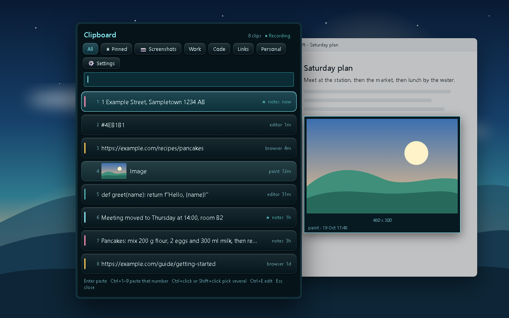

# Clipboard

A clipboard history for Windows: copy as usual, press a hotkey, and pick any earlier clip from a soft, themed card list.



*Screenshot uses made-up example clips.*

## What it does

- Remembers your recent copies: text, links, code, images and files.
- Opens with **Ctrl+Alt+V** (you can change the hotkey in Settings) and pastes the clip you choose.
- Tabs for All, Pinned and your own tags, plus search, colour stripes and image thumbnails.
- Pick several clips at once and paste them together, or edit a clip before pasting.
- "Paste as" tools: UPPERCASE, lowercase, Title Case, trim, one line, clean links, sort lines.
- Three looks (Flat, Raised, Glass), colour themes and a Settings tab for almost everything.

### Keys

| Key | Action |
| --- | --- |
| Enter | Paste the selected clip |
| Ctrl+1 to Ctrl+9 | Paste the numbered row |
| Ctrl+click or Ctrl+Space | Pick several clips |
| Ctrl+E | Edit a clip before pasting |
| Ctrl+R | Pause or resume recording |
| Ctrl+P / Ctrl+T | Pin / cycle tag |
| Ctrl+Left / Ctrl+Right | Switch tab |
| Ctrl+Delete | Delete a clip |
| Esc | Close |

## Run it

You need Windows and Python 3 (the standard install includes Tkinter).

```
pip install -r requirements.txt
pythonw main.py
```

`pythonw` runs it without a console window. Use `python main.py` if you want to see error messages.
Pillow (in `requirements.txt`) is only needed for images and the card drawing.

To start it with Windows, put a shortcut to `main.py` in your Startup folder (press Win+R, type `shell:startup`).

Tests: `python tests/run_all.py -v`. They never show a window and never touch your real clipboard or history.

## Privacy

- Your history stays on your computer. It is saved in `%APPDATA%\Clipboard`, never in the project folder, and the app opens no network port and sends nothing anywhere.
- Clipboard history can contain passwords, so copies from password managers (KeePass, Bitwarden, 1Password and similar) are skipped. Clips that a program marks as "do not record" are skipped too.
- Texts that look like private keys or HoYoLAB login cookies are never saved (see `SKIP_PATTERNS` in `config.py`).
- You can add more apps to the "never record" list in Settings, and pause recording any time with Ctrl+R.
- Each clip remembers which program it came from (for example "chrome"), only to label the card.

## Files

`main.py` starts everything. `watcher.py` saves copies, `store.py` is the SQLite history, `winclip.py` talks to Windows.
`ui.py` is the window, `rowcard.py` one clip card, `look.py` the three looks, `settingspage.py` the Settings tab,
`texttools.py` and `autotag.py` the text changes and tag guesses, `settings.py` and `themes.py` your choices.

## Licence

MIT, see [LICENSE](LICENSE).

More projects: https://github.com/Shamilimanuel
